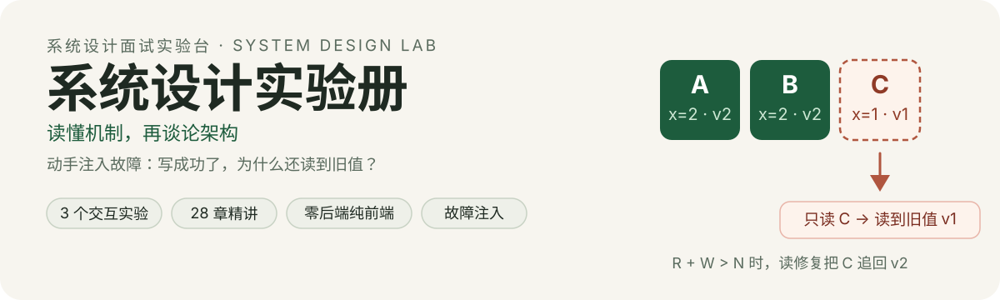
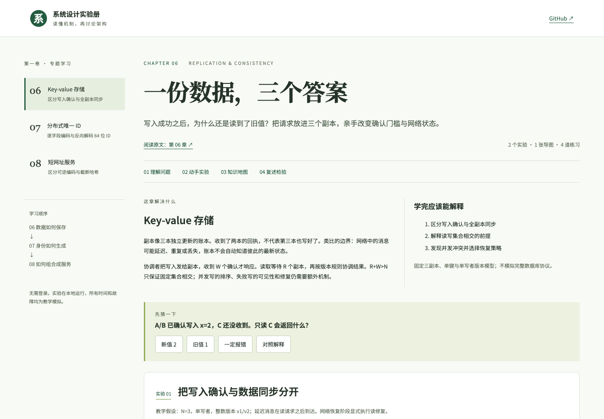
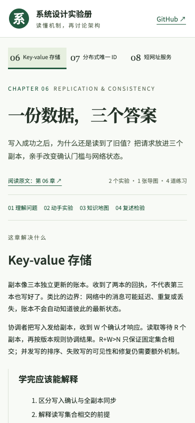

<p align="right"><a href="README.md">中文</a></p>

<p align="center">
  
</p>

<p align="center">
  <a href="https://holynova.github.io/system-design-learning-lab/">▶ Try the Lab Online</a>
  ·
  <a href="https://github.com/holynova/system-design-learning-lab">GitHub Repository</a>
  ·
  <a href="https://learning-guide.gitbook.io/system-design-interview">Companion Reading Guide</a>
</p>

System Design Learning Lab is an interactive workbench for chapters 6–8 of Alex Xu's *System Design Interview* (Vol. 1): zero-backend, pure-frontend state machines. Tune R / W quorums, inject network partitions and clock skew, and watch every delay, overflow, and cache stampede happen for real. Understand the mechanism before discussing the architecture.

## Screenshots

<p align="center">
  
  
</p>

## The 3 Labs

### Lab 01 · Chapter 06: Key-Value Store — One Write, Three Answers

- **3-replica model (N=3)**: replicas A, B and C all start at x=1 (version v1); a write sets x=2 (single writer bumps the version to v2).
- **Tunable quorums**: write acknowledgements W ∈ [1, 3] and read responses R ∈ [1, 3] are adjustable; with W=2 the client already got a write success, yet C may still be stuck at v1.
- **Fault injection**: mark C as network-isolated, or add message delay to C — then read, and a read hitting only C returns the stale v1.
- **Read repair**: when the read set covers both A and C (satisfying R + W > N), the coordinator returns v2 by version number and backfills C to v2 in the background.
- **Going deeper**: compare how LWW and vector clocks merge differently in a shopping-cart scenario.

### Lab 02 · Chapter 07: Snowflake — Take Apart a Unique ID

- **64-bit field-by-field visualization**: 1 sign bit + 41-bit millisecond timestamp (69 years of headroom) + 5-bit datacenter ID + 5-bit machine ID + 12-bit sequence number (0–4095); exact BigInt shifts, zero precision loss.
- **4097 capacity test**: inject a burst of requests in the same millisecond — the sequence climbs from 0 to 4095, and the 4097th request trips the exhaustion guard and blocks until the next millisecond.
- **Clock-rollback injection**: simulated time rolls back from 1000ms to 995ms — watch the generator refuse to issue IDs or spin safely.
- **Identity collision**: two nodes misconfigured with the same datacenter and machine IDs produce duplicate IDs under high concurrency.

### Lab 03 · Chapter 08: URL Shortener — Where Does One Click Go?

- **Base62 bijective encoding**: alphabet `[0-9a-zA-Z]`, lossless round-trip between a unique auto-incrementing integer and its short code (e.g. `11157` ↔ `2TX`).
- **Truncated hashing and collisions**: FNV-1a hashes truncated to fixed-length short codes; when two long URLs collide on one code, salted retries and a unique index save the day.
- **301 vs 302**: a 301 permanent redirect is aggressively cached by the browser, so later clicks bypass the server (skewing analytics); a 302 hits the origin every time — accurate tracking, more load.
- **Full event log**: `Browser Cache Miss` → `Redirect Service Lookup` → `Server Cache / DB Hit` → `Counter Increment`, all visible.

Each chapter also has a knowledge map, 4 exercises, myth-busting notes and a 90-second recap; lab state is fully preserved when switching between chapters.

## All 28 Chapters

`chapters/` holds interview-oriented notes for all 28 chapters of Volumes 1 & 2 (tradeoff comparisons + key talking points):

- **Volume 1 (15 chapters)**: Scale from Zero to Millions of Users, Back-of-the-Envelope Estimation, A Framework for System Design Interviews, Rate Limiter, Consistent Hashing, Key-Value Store, Unique ID Generator, URL Shortener, Web Crawler, Notification System, News Feed System, Chat System, Search Autocomplete, YouTube, Google Drive.
- **Volume 2 (13 chapters)**: Proximity Service, Nearby Friends, Google Maps, Distributed Message Queue, Metrics Monitoring and Alerting, Ad Click Aggregation, Hotel Reservation, Distributed Email Service, S3-like Object Storage, Real-Time Gaming Leaderboard, Payment System, Digital Wallet, Stock Exchange.

## Run Locally

```bash
npm install
npm run dev       # dev server
npm run build     # production build (output in docs/)
npm test          # mechanism checks: Snowflake encode/decode, Base62, KV scenarios
```

## Tech

- React + Vite, pure-frontend state-machine simulation, zero backend; every lab runs locally in the browser with no outbound requests.
- The core models live in `src/models.js` (Base62 / Snowflake encode-decode / FNV-1a hashing / KV scenario simulation); content in `src/content.js`.
- Teaching boundaries (see `REBUILD.md`): a fixed 3-replica single-writer model, not a substitute for production Raft/Paxos; the URL-shortener lab performs no real redirects; the hash is a deterministic teaching hash.

```
src/main.jsx            Entry and lab UI
src/models.js           Core models: Base62 / Snowflake / FNV-1a / KV simulation
src/content.js          Three chapters of content (lessons / exercises / knowledge maps)
chapters/               28 chapters of interview notes (Markdown)
scripts/verify.mjs      Mechanism verification script (npm test)
01-03*.md / REBUILD.md  Study conventions, chapter index, build plan and acceptance
```
