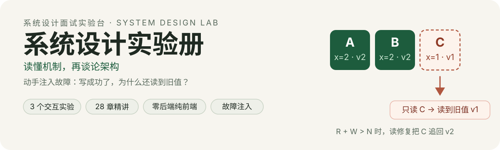
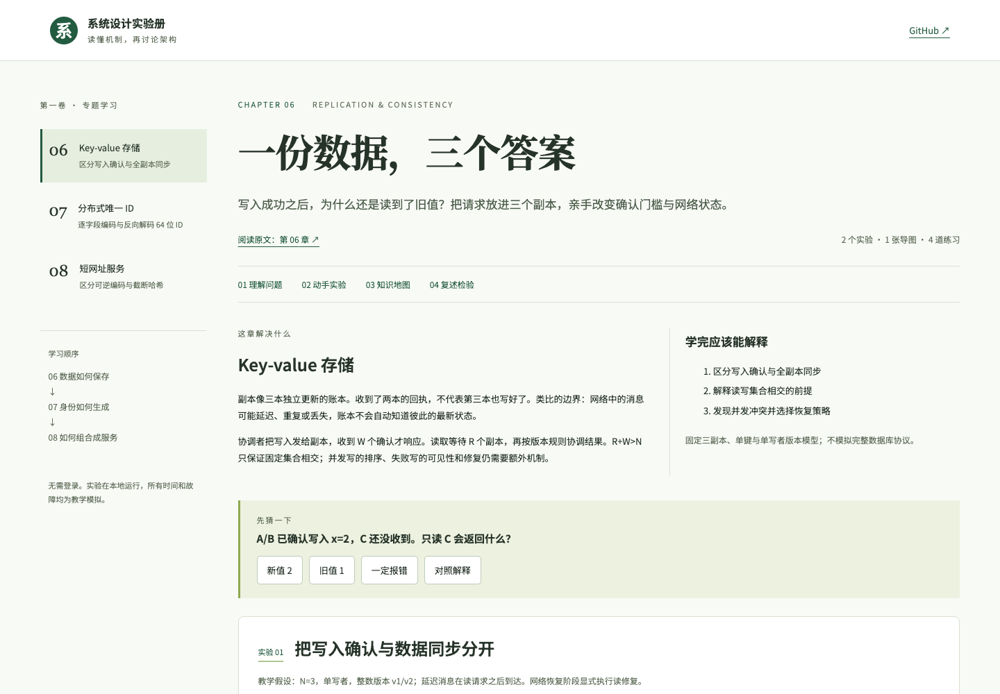
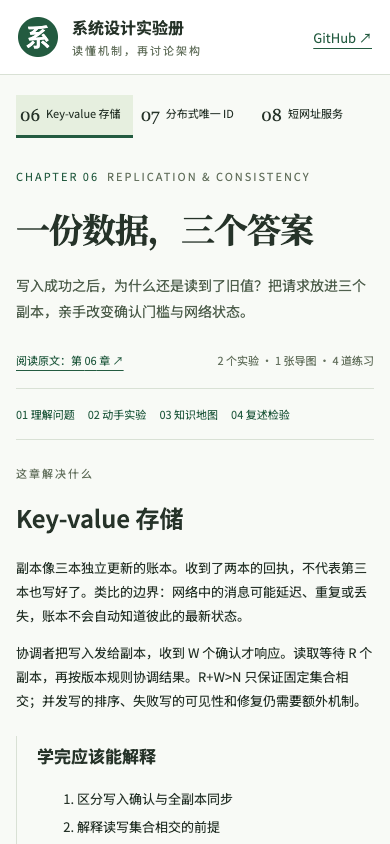

<p align="center">
  
</p>

<p align="center">
  <a href="https://holynova.github.io/system-design-learning-lab/">▶ 在线做实验 Play Online</a>
  ·
  <a href="https://github.com/holynova/system-design-learning-lab">GitHub 仓库</a>
  ·
  <a href="https://learning-guide.gitbook.io/system-design-interview">配套教材精读指南</a>
</p>

系统设计实验册是 Alex Xu《系统设计面试》第一卷第 6、7、8 章的交互实验台：把抽象的分布式机制重构成零后端、纯前端的状态机——亲手调 R / W 门槛、注入网络分区与时钟回拨，看每一次延迟、溢出与缓存击穿如何真实发生。读懂机制，再谈论架构。

System Design Learning Lab is an interactive workbench for chapters 6–8 of Alex Xu's *System Design Interview* (Vol. 1): zero-backend, pure-frontend state machines. Tune R / W quorums, inject network partitions and clock skew, and watch every delay, overflow, and cache stampede happen for real. Understand the mechanism before discussing the architecture.

## 截图 / Screenshots

<p align="center">
  
  
</p>

## 三个实验 / The 3 Labs

### 实验 01 · 第 06 章：KV 存储——一份数据，三个答案

- **三副本模型（N=3）**：副本 A、B、C 初始均为 x=1（版本 v1）；写入 x=2（单写者递增版本 v2）。
- **调门槛**：写确认 W ∈ [1, 3]、读响应 R ∈ [1, 3] 可调；W=2 时客户端已收到写成功，但 C 可能还停在 v1。
- **故障注入**：把 C 标记为网络隔离，或给 C 开消息延迟；再读——只命中 C 就读到旧值 v1。
- **读修复**：读集合同时覆盖 A 和 C（满足 R + W > N）时，协调者按版本号返回 v2，并后台把 C 追回 v2。
- **进阶**：对比 LWW 与向量时钟在购物车场景下的不同合并策略。

### 实验 02 · 第 07 章：Snowflake——拆开一个唯一 ID

- **64 位逐字段可视化**：1 位符号位 + 41 位毫秒时间戳（可用 69 年）+ 5 位数据中心 ID + 5 位机器 ID + 12 位序列号（0–4095）；BigInt 精确位移，零精度损失。
- **4097 容量测试**：同一毫秒注入批量请求，序列号从 0 递增到 4095，第 4097 个请求触发耗尽保护，阻塞等待下一毫秒。
- **时钟回拨注入**：仿真时间从 1000ms 回拨到 995ms，看发号器拒绝发号或安全自旋。
- **身份碰撞**：两个节点误配相同数据中心与机器 ID，观察高并发下的重复 ID 事故。

### 实验 03 · 第 08 章：短网址——一次点击，去了哪里

- **Base62 双射编解码**：字符集 `[0-9a-zA-Z]`，唯一自增整数与短码无损互转（例如 `11157` ↔ `2TX`）。
- **截断哈希与碰撞**：FNV-1a 哈希截断为固定长度短码；两个长链接撞到同一短码时，看加盐重试与唯一索引如何兜底。
- **301 vs 302**：301 永久重定向被浏览器强缓存、后续点击绕过服务端（统计失真）；302 每次回源、埋点准确但增加负载。
- **全链路日志**：`Browser Cache Miss` → `Redirect Service Lookup` → `Server Cache / DB Hit` → `Counter Increment` 全程可见。

每章另有知识地图、4 道练习、误区粉碎与 90 秒复述；实验状态在三章之间切换时完整保留。

## 28 章精讲库 / All 28 Chapters

`chapters/` 收录第一卷与第二卷全部 28 章的面试重构精讲（权衡对比 + 答辩要点）：

- **第一卷（15 章）**：从零到百万用户、粗略估算、面试框架、限流器、一致性哈希、KV 存储、唯一 ID 生成器、短网址、网络爬虫、通知系统、新闻提要系统、聊天系统、搜索自动完成、YouTube、Google Drive。
- **第二卷（13 章）**：邻近服务、附近的好友、谷歌地图、分布式消息队列、指标监控与告警、广告点击聚合、酒店预订、分布式邮件服务、类 S3 对象存储、实时游戏排行榜、支付系统、数字钱包、股票交易所。

## 本地运行 / Run Locally

```bash
npm install
npm run dev       # 开发服务器
npm run build     # 生产构建（输出到 docs/）
npm test          # 机制验证：Snowflake 编解码、Base62、KV 场景
```

## 技术 / Tech

- React + Vite，纯前端状态机模拟，零后端；所有实验在浏览器本地运行，不发起外网请求。
- 核心模型在 `src/models.js`（Base62 / Snowflake 编解码 / FNV-1a 哈希 / KV 场景推演），内容在 `src/content.js`。
- 教学边界（见 `REBUILD.md`）：固定三副本单写者模型，不代替生产级 Raft / Paxos；短网址实验不做真实重定向；哈希是确定性教学哈希。

```
src/main.jsx            入口与实验台 UI
src/models.js           核心模型：Base62 / Snowflake / FNV-1a / KV 推演
src/content.js          三章内容（讲解 / 练习 / 知识地图）
chapters/               28 章面试精讲（Markdown）
scripts/verify.mjs      机制验证脚本（npm test）
01-03*.md / REBUILD.md  学习规范、章节索引、制作路线与验收
```

## English

**System Design Learning Lab** is an interactive workbench for chapters 6–8 of Alex Xu's *System Design Interview* (Vol. 1) — zero-backend, pure-frontend state machines, plus all 28 chapters as interview notes in `chapters/`.

- **Lab 01 · Ch.06 KV store**: 3 replicas (N=3), tunable R / W quorums, partition and delay injection, read-repair when R + W > N; LWW vs vector clocks compared.
- **Lab 02 · Ch.07 Snowflake**: 64-bit field-by-field visualization (1 + 41 + 5 + 5 + 12) with exact BigInt shifts; 4097-request same-millisecond overflow test; clock-rollback injection (1000ms → 995ms); duplicate-ID collision test.
- **Lab 03 · Ch.08 URL shortener**: Base62 bijection (`11157` ↔ `2TX`), truncated FNV-1a hashing with collision probing, 301 vs 302 cache-and-analytics tradeoff, full event log.
- **28 chapters**: Vol. 1 (15) + Vol. 2 (13) as structured interview notes with tradeoffs and key points.
- **Run it**: `npm install && npm run dev`. Verify the mechanisms with `npm test`.
- **Tech**: React + Vite, pure client-side simulation. Teaching models only — the fixed 3-replica single-writer model does not replace production Raft/Paxos.
