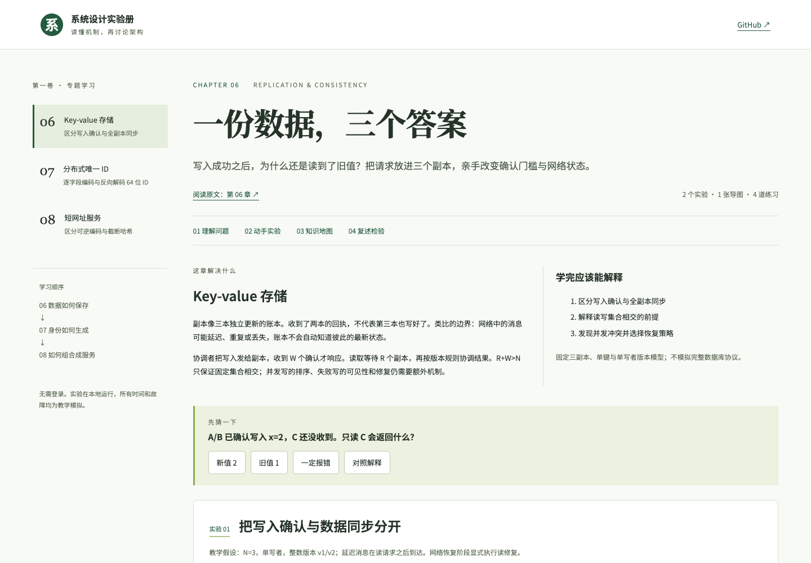

# 系统设计实验册

从需求与原书重做，聚焦第一卷第 6、7、8 章：操作 KV 副本与确认门槛，拆解 Snowflake ID 并注入时钟故障，创建短码、制造冲突并追踪缓存跳转。每章包含知识地图、四道练习、误区讲解和本地学习笔记。所有请求均为教学模拟。

[在线学习](https://holynova.github.io/system-design-learning-lab/) · [GitHub 仓库](https://github.com/holynova/system-design-learning-lab) · [原书](https://learning-guide.gitbook.io/system-design-interview)




## 从哪一章开始

| 实验 | 动手探索 |
| --- | --- |
| KV 存储 | 改变副本与确认门槛，观察读写行为 |
| Snowflake ID | 拆解 ID，注入时钟故障 |
| 短网址 | 创建短码、制造冲突，追踪缓存跳转 |

## 本地运行

```bash
npm install
npm run dev
```

打开终端输出的本地地址。构建命令：

```bash
npm run build
```

构建输出至 `docs/`，GitHub Pages 使用 `master:/docs`。浏览器验证脚本为 `node scripts/verify.mjs`；执行环境与访问地址见该脚本。

版本 1.0.0。旧版本保存在 Git 历史中。重建范围与模型边界见 [REBUILD.md](REBUILD.md)。
