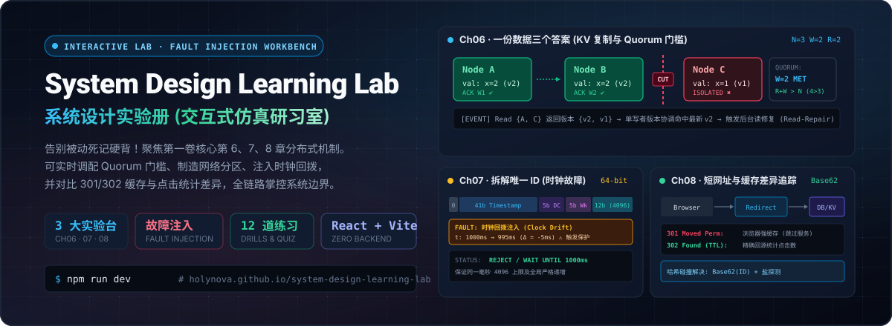
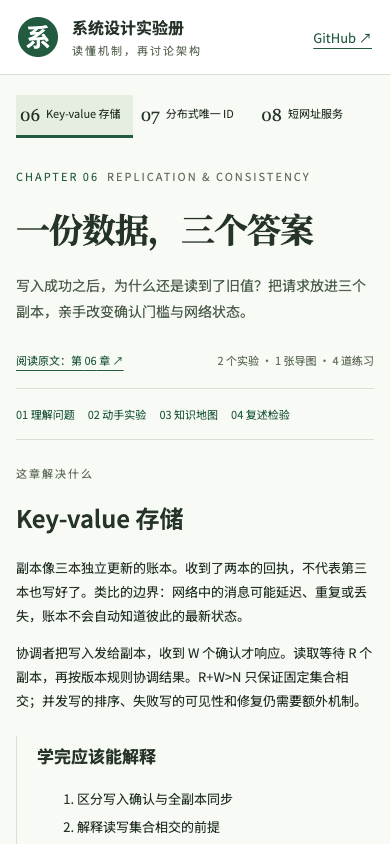

<p align="center">
  
</p>

<p align="center">
  <a href="https://holynova.github.io/system-design-learning-lab/"></a>
  <a href="https://react.dev/"></a>
  <a href="https://vite.dev/"></a>
  <a href="#-实验台核心机制与章节拆解"></a>
  <a href="#-运行与工程验证"></a>
  <a href="./LICENSE"></a>
</p>

---

## 🔬 实验册定位：为什么需要动手注入故障？(Value Proposition)

在研读分布式系统与系统设计面试经典时，工程师往往困在理论描述与八股概念中：
- 背下了 **$W + R > N$** 的法定人数公式，但在网络分区、节点延迟确认与单写者递增版本模型中，依然无法直观解释**“写成功了，为什么读请求还是读到了旧值”**；
- 熟知 **Twitter Snowflake** 的 64 位比特分割，却从未亲手追踪过**同一毫秒第 4097 次请求溢出**、**机器时钟从 1000ms 突变倒退至 995ms** 时发号器真实的阻塞或拒绝状态；
- 了解 **短网址与 Base62**，却经常忽略 **HTTP 301 永久重定向（浏览器强缓存直接绕过服务端，导致点击统计失真）** 与 **HTTP 302 临时重定向（严格回源保障埋点准确）** 之间的关键工程取舍。

**《系统设计实验册》（System Design Learning Lab）** 抛弃泛泛的概念搬运，立足原书第一卷最核心的 **第 6、7、8 章**，把抽象的分布式机制重构成**零后端依赖、纯前端高保真状态机运行的可交互实验台**。

每一次网络延迟、每一个比特位移、每一次缓存击穿，都在毫秒级的可视化推演日志中真实呈现！

---

## 🌐 在线体验与源码入口 (Live Demos)

| 入口通道 | 访问链接 | 说明 |
| :--- | :--- | :--- |
| 🚀 **GitHub Pages 线上实验册** | [holynova.github.io/system-design-learning-lab](https://holynova.github.io/system-design-learning-lab/) | 纯前端极速秒开，适配桌面与移动端 |
| 💻 **GitHub 源码仓库** | [github.com/holynova/system-design-learning-lab](https://github.com/holynova/system-design-learning-lab) | 欢迎 Star 与提交 PR 丰富更多实验分支 |
| 📖 **配套教材参考** | [learning-guide.gitbook.io](https://learning-guide.gitbook.io/system-design-interview) | Alex Xu 系统设计面试原书精读指南 |

### 📱 手机扫码实时实验
扫描下方二维码，随时随地在手机浏览器中进行系统设计参数调优与故障推演：

<p align="center">
  
</p>

---

## 🖥 实验台实景界面 (Workbench Showcase)

<p align="center">
  
</p>

<p align="center">
  
</p>

- **状态机推演控制台**：支持逐步单步步进（Step-by-step Execution）与快照回放；
- **真实参数滑块与注入开关**：动态切换 $R$ / $W$ 门槛、切换网络通断状态、推进仿真毫秒时钟；
- **全链路本地学习闭环**：每章集成“知识拓扑地图”、“4 道实战诊断题”、“误区粉碎机”、“90 秒面试答辩复述”以及“本地学习笔记导出”。

---

## 🧪 实验台核心机制与章节拆解 (Deep-Dive Lab Consoles)

### 📌 实验 01（第 06 章）：一份数据，三个答案 (Key-Value 存储)
> **探索命题**：写入成功之后，为什么读取端依然可能拿到旧值？副本同步延迟与网络分区究竟如何影响系统一致性？

- **三副本模型 ($N=3$)**：固定配置副本节点 $A$、$B$、$C$，初始状态均为 $x=1$（版本号 $v1$）；
- **动态读写门槛调节**：
  - 调整写确认门槛 $W \in [1, 3]$ 与读响应门槛 $R \in [1, 3]$；
  - 模拟写入 $x=2$（单写者递增版本 $v2$）；
- **网络分区与故障注入**：
  - 故意将副本 $C$ 标记为网络隔离，或为 $C$ 开启消息延迟到达；
  - 观测达到 $W=2$ 时客户端即收到写成功，但此时 $C$ 仍然停留在 $v1$；
- **读取路径与读修复 (Read-Repair)**：
  - 发起读请求，若读集合只命中了 $C$，则读出旧值 $v1$；
  - 若读集合同时覆盖 $A$ 和 $C$（满足 $R+W > N$），协调者基于版本号 $v2 > v1$ 返回最新值，并触发后台**读修复机制**，自动将 $C$ 追赶回 $v2$；
- **并发冲突进阶对比**：对比基于单调版本号的 LWW（Last-Write-Wins 存在时钟风险）与多维度向量时钟（Vector Clock 并发冲突检测）在购物车场景下的不同合并策略。

---

### 📌 实验 02（第 07 章）：拆开一个唯一 ID (分布式 Snowflake)
> **探索命题**：一个 64 位整数如何严密容纳时间、机器身份与同一毫秒内的高并发请求？时钟回拨发生时会发生什么？

- **64-bit 结构逐字段可视化**：
  - `1 位符号位 (0)` + `41 位毫秒时间戳 (可用 69 年)` + `5 位数据中心 ID (0~31)` + `5 位机器 Worker ID (0~31)` + `12 位序列号 (0~4095)`；
  - 基于 JavaScript 原生 `BigInt` 精确位移运算（`<< 22n`、`<< 17n`、`<< 12n`），零精度损失；
- **单毫秒高并发突发压测 (4097 容量测试)**：
  - 同一毫秒内注入批量请求，观察序列号从 `0` 递增至 `4095`；
  - 当第 4097 个请求到达时，触发序列号耗尽保护，系统自动阻塞并等待仿真时钟迈入下一毫秒；
- **时钟回拨故障注入 (Clock Backward Injection)**：
  - 强制将系统仿真时间从 `1000ms` 回拨至 `995ms`（偏差 $\Delta = -5ms$）；
  - 观察发号器触发保护策略：严格拒绝发号或进入安全自旋等待，避免生成重复 ID；
- **身份碰撞试验**：模拟两个不同节点被误配置为相同的数据中心与机器 ID，观察在微秒级高并发下产生的严重重复 ID 事故。

---

### 📌 实验 03（第 08 章）：一次点击，去了哪里 (短网址与重定向)
> **探索命题**：从长链接生成短码、处理哈希碰撞，到追踪每一次点击，浏览器的跳转缓存是如何悄悄吞噬你的服务端统计数据的？

- **Base62 双向双射编解码**：
  - 字符集 `[0-9a-zA-Z]`（62 进制），实现唯一自增整数与短码的无损压缩（例如：`11157` 编码为 `2TX`）；
- **截断哈希与碰撞探测 (Hash Collision & Probing)**：
  - 基于 FNV-1a 哈希截断为固定长度短码；
  - 模拟两个不同长链接映射到相同短码时的冲突探测逻辑，展示加盐重试（Salting & Probing）与唯一性索引约束保护；
- **301 vs 302 缓存差异追踪**：
  - **301 Moved Permanently**：浏览器记录永久强缓存，后续同一链接的点击将由浏览器本地直接跳转，服务端访问计数器不再递增（数据统计失真）；
  - **302 Found (临时重定向)**：浏览器每次请求均回源向短链服务发起查询，服务端完整记录每一次点击事件、IP 与来源，但增加了服务器与数据库的解析负载；
- **全链路事件日志流**：详细输出 `Browser Cache Miss` $\to$ `Redirect Service Lookup` $\to$ `Server Cache / DB Hit` $\to$ `Counter Increment` 的全部执行流水。

---

## 📖 完整 28 章系统设计面试研习知识库 (`chapters/`)

除了在 Web 实验台中深度交互的 6、7、8 三章外，本项目仓库的 `chapters/` 目录完整收录了 Alex Xu 系统设计面试第一卷与第二卷全部 28 个章节的**面试重构精讲、权衡对比与答辩核心要点**：

- **第一卷 (V1 核心基建)**：从零扩展到百万用户、容量估算、面试四步法、限流器、一致性哈希、分布式 KV、雪花 ID、短网址、网络爬虫、通知系统、News Feed 信息流、实时聊天、搜索自动补全、YouTube 视频转码、Google Drive 云盘同步。
- **第二卷 (V2 高并发实战)**：邻近位置服务、附近的好友、谷歌地图导航、分布式消息队列、时序监控与告警、广告点击流聚合、酒店预订防超卖、邮件全文检索、类 S3 纠删码对象存储、游戏排行榜跳表、分布式支付系统、数字钱包 Saga 事务、股票撮合交易所。

---

## 🛠 运行与工程验证 (Run & Verify)

### 1. 本地开发与运行
本项目基于轻量现代化的 Vite + React 架构构建：

```bash
# 1. 安装项目依赖
npm install

# 2. 启动本地开发热重载服务器 (访问 http://localhost:5173)
npm run dev

# 3. 生产环境静态打包 (输出至 docs/ 目录以供 GitHub Pages 部署)
npm run build

# 4. 本地预览生产构建产物
npm run preview
```

### 2. 自动化验证脚本
仓库内置了端到端机制验证脚本：
```bash
# 执行自动化验证脚本
node scripts/verify.mjs
```
该脚本将严格验证：
- Snowflake 编解码器在极限边界下的双向一致性；
- Base62 编码与反向解码的数学正确性；
- KV 存储在不同 $R$ / $W$ 门槛与网络分区状态下的预期状态输出。

---

## 📐 实验边界与教学模型声明 (Simulation Boundaries)

依据 [REBUILD.md](./REBUILD.md) 的设计规范：
1. **教学模拟性质**：固定三副本单写者模型用于清晰展示法定人数与读修复机理，不代替生产级 Raft / Paxos 或分布式线性一致性数据库；
2. **纯客户端沙箱**：短网址与重定向实验的所有链接均在浏览器沙箱内模拟完成，不发起外网真实重定向跳转；哈希函数采用确定性教学哈希，不伪装成高开销的加密安全哈希；
3. **确定性状态保留**：在 6、7、8 三个实验台之间随意切换时，系统完整保留当前正在推演的参数与故障注入状态，支持跨章节对照思考。

---

## 📄 许可协议 (License)

本项目采用 [MIT License](./LICENSE) 开源协议。欢迎加入学习与共同演进！
